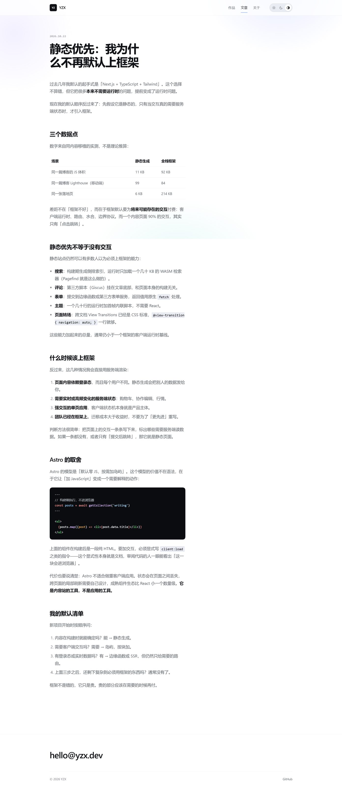

# YZX · 个人网站

一个零框架运行时的静态个人站：Astro 7 负责构建，视觉层用 DSH 的设计令牌（vendor 源码），客户端只有一个几 KB 的主题模块，外加首页那块实时生成的 ASCII 风场。

- 首页 / 作品 / 文章 / 关于 / 404，共 8 个静态页面
- 明暗双主题 + 跟随系统，首帧不闪
- 首页 hero 是一块随指针与时间变化的 ASCII 笔画风场（Canvas 2D，零依赖），减少动效与禁用 JS 时退回同一帧的静态图
- 全站 JS ≈ 16 KB（构建后，含主题运行时与风场模块），CSS ≈ 43 KB（gzip 后约 7.8 KB）
- 部署目标：任意静态托管，推荐 Cloudflare Pages

## 设计原则

首页只有一句宣言、两个列表、一个邮箱。没有小标题、摘要、按钮、标签 —— 作品与文章靠「年份」和「完整日期」的格式差异、以及两段之间的留白区分，而不是靠文字说明。

- 少一层装饰就少一次解释：层级由字号、间距、对齐和颜色承担。
- 艺术层不是一张装饰图，而是页面自己算出来的：首页那屏约一万个 ASCII 笔触按风速场转向，密度起伏成沙丘，光池缓慢漂移，指针靠近会拨动局部风向。视觉语言取自 [living-ascii](https://github.com/24373054/living-ascii)（MIT），但实现改成零依赖的 Canvas 2D。
- 客户端只保留一个主题模块和一块风场；渐变、噪点、超椭圆圆角、页面转场全部是 CSS。禁用 JS 后页面依然可读（此时固定浅色，因为暗色令牌由 `body[data-ds-dark-theme]` 激活，缺了脚本就不该切深色画布），首页 art 用同一时刻的静帧。
- 视觉与动效规范参考 Google Chrome 的 [modern-web-guidance](https://github.com/GoogleChrome/modern-web-guidance)：字号用 rem、`clamp()` 的上下限比值不超过 2.5、标题 `text-wrap: balance` / 正文 `text-wrap: pretty`、减少动效按规则逐条关闭而非常量时长、深色模式由 `color-scheme` 驱动。该 skill 装在 `.agents/skills/` 并随仓库提交（见 `skills-lock.json`）。

## 预览

| 首页 · 浅色 | 首页 · 深色 |
| --- | --- |
|  |  |

文章页（`/writing/static-first`）：



移动端：

| 首页 | 文章 |
| --- | --- |
|  |  |

> 图片由 `tools/preview_images.py` 从 `.shots/` 的实拍截图生成，改版后重跑即可。

## 技术栈

| 层 | 选择 | 说明 |
| --- | --- | --- |
| 构建 | Astro 7.4 | 静态输出、内容集合、MDX、sitemap、RSS |
| 语言 | TypeScript 5.9 | `astro check` 尚不支持 TS 7，故锁 5.9 |
| 样式 | DSH tokens + 原生 CSS | 令牌提供颜色/排版/阴影/圆角；无 Tailwind |
| 主题 | DSH theme runtime | 纯 TS、零依赖、零 React，约 40 行 DOM 投影 |
| 艺术层 | Canvas 2D（手写） | 首页 ASCII 风场，约 4.9 KB JS，无第三方渲染库 |
| 内容 | MDX + content collections | frontmatter 由 Zod schema 在构建期校验 |

不使用 Tailwind 是有意的：DSH 令牌已覆盖设计层，引入 Tailwind 只会产生第二套并行体系。样式集中在 `src/styles/site.css`，用命名约定（`shell` / `section` / `row` / `prose`）约束作用域。

## 本地命令

```bash
pnpm install
pnpm dev        # http://localhost:4321
pnpm build      # 输出到 dist/
pnpm preview    # 预览构建产物
pnpm check      # astro check 类型检查（0 errors 是提交线）
```

Node 版本：24.x（本仓库用 pnpm 10）。

## 目录

```text
src/
  config.ts             站点元信息（标题、简介、宣言、关于、导航、邮箱、社交链接）
  data/projects.ts      作品列表（纯数据，改这里即可）
  content.config.ts     文章 frontmatter 的 Zod schema
  content/writing/*.mdx 文章
  design/tokens/        vendor 自 dsh-ui-kit 的设计令牌（CSS + 常量）
  design/theme/         vendor 自 dsh-ui-kit 的主题运行时（TS，无 React）
  layouts/Base.astro    文档骨架、meta、首帧主题脚本
  components/           SiteHeader / SiteFooter / WorkRow / PostRow
  pages/                index / work / writing / about / 404 / rss.xml
  scripts/theme.ts      客户端：ThemeRuntime + 主题按钮
  scripts/ascii-field.ts 首页 ASCII 风场（Canvas 2D，零依赖）
  styles/site.css       站点层样式（显示级字阶、编排、art layer）
  lib/format.ts         日期格式化
public/                 favicon.svg、og.png、robots.txt、hero-field-{light,dark}.{avif,webp} 静帧
tools/                  og 图 / 静帧生成、截图与裁剪脚本（仅本地用）
refs/dsh-ui-kit/        vendor 的上游仓库（只读参考，不参与构建）
refs/living-ascii/      艺术语言参考仓库（只读参考，不参与构建）
.agents/skills/         modern-web-guidance skill（随仓库提交，见 skills-lock.json）
```

## 常见改动

**改站点信息**：`src/config.ts` 的 `site` 对象是唯一入口（标题、定位、首页宣言、关于两行、邮箱、社交、导航）。

**加一个作品**：在 `src/data/projects.ts` 里追加一条。有 `href` 时整行变成外链，没有则渲染成不可点的条目。`featured: true` 的进入首页，其余只在作品页出现。`summary`、`role`、`tags` 仍保留在数据里备用，当前界面只渲染标题和年份。

**写一篇文章**：新建 `src/content/writing/我的文章.mdx`，frontmatter 必填项：

```yaml
---
title: 标题
description: 一句话摘要（用于 meta description 与 RSS；列表只显示标题和日期）
date: 2026-11-13
tags: ['设计系统', 'CSS']
draft: false   # 可选，true 时不上线
---
```

文件名即 URL：`/writing/<文件名>/`。列表按日期倒序，RSS 与 sitemap 自动更新。

**换配色**：优先改 `src/design/tokens/styles/design-platform.css` 里的 alias 映射，而不是组件里的颜色。要加自己的 token，写进 `src/styles/site.css` 的 `:root`，并确保明暗两套都有值。

## 主题机制

主题要解决三件事：首帧不闪、用户能手动切换、跟随系统时不重复计算。

1. `<head>` 内联脚本：在样式表之前读 `localStorage['site-theme']`，算出真实明暗，写 `html[data-ds-theme-source]` 和 `color-scheme`。
2. `<body>` 开头内联脚本：写 `body[data-ds-dark-theme]`（令牌的深色分支靠这个属性激活）。
3. `src/scripts/theme.ts`：`new ThemeRuntime({ persistence })` 接管系统主题监听，`presentTheme(runtime)` 把快照投影到 DOM；三个按钮通过 `runtime.setTheme('light' | 'dark' | 'system')` 更新偏好并持久化。

运行时不知道 DOM 存在，presenter 不判断主题——所以主题逻辑可以脱离浏览器单测，也可以换渲染目标。改主题行为时优先动这两层，而不是加新的全局状态。

## 首页的艺术层

`src/scripts/ascii-field.ts` 在首页 hero 的 canvas 上画一块 ASCII 风场。它不是图片，也不是 WebGL：一屏切成 6–10 px 的方格，每格画一根方向由风场决定的小笔画。

- **笔画精灵**：8 个角度 × 4 档长度/粗细，每种组合预渲染成一张小 canvas。按需生成并缓存，避免首帧一次性建 448 张精灵造成长任务。
- **风场**：几组正弦叠加出转向；另一条横穿的密度沙丘带把 `dune` 阈值化，得到成片的"草场"与空隙；一团漂移光池只抬色调、不改密度。指针靠近处风向往上/下偏、色调变亮。
- **配色**：每格从 `--field-tone-1/2/3` 三段色带按 tone 取值，因此明暗两套只需换 CSS 变量（`src/styles/site.css` 的 `:root` 与 `body[data-ds-dark-theme]`）；胶片颗粒用 `--field-grain`。
- **生命周期**：`IntersectionObserver` 离开视口、`contentvisibilityautostatechange` 被跳过、标签页隐藏、`prefers-reduced-motion: reduce`，任一成立就停 rAF；`ResizeObserver` 重建网格；body 的 `data-ds-dark-theme` 变化时重建调色板。
- 帧率 30 fps（`FRAME_MS = 33`），单帧上限 14,000 格，DPR 上限 2。

**静帧回退**：`STATIC_TIME = 11.5` 是画布初始化时画的那一帧，静态图也由同一时刻生成，所以静图切到动画不会跳帧。静图通过 CSS 变量 `--field-still` 引用，只在 `prefers-reduced-motion: reduce` 或 `<noscript>` 时才真正发起请求 —— 正常访客完全不下载这一百多 KB。

改完风场参数后重生成静帧：

```bash
node tools/make-field-stills.mjs        # dev server 起着的状态下：写 docs/field-{light,dark}.png
python tools/make-field-webp.py         # 压成 public/hero-field-*.{avif,webp}
node tools/field-shot.mjs               # 只截面板，用于快速迭代
```

## vendor 的 DSH 源码

`src/design/tokens` 和 `src/design/theme` 不是 npm 依赖，而是从 `refs/dsh-ui-kit`（MIT）复制过来的源码：

- tokens 的 npm 包不含构建产物（`main` 指向的 `dist/index.js` 不存在），theme/core 未发布，所以不能直接安装。
- 复制进仓库后，主题运行时的唯一外部引用被改成了本地 `../tokens` 常量。

**升级方式**：对比上游 `packages/tokens/src` 与 `packages/theme/src`，把差异同步进来，保持两处导入改写（`@dsh-ui/tokens` → `../tokens`、`./x.ts` → `./x`）。不要引入 `theme/react.ts`——它需要 React。

## 部署（Cloudflare Pages）

1. 把 `astro.config.mjs` 的 `site` 改成真实域名，`public/robots.txt` 里的 sitemap 地址同步改。
2. 推送到 GitHub，Cloudflare Pages 连接仓库：
   - Build command：`pnpm build`
   - Build output：`dist`
   - 环境变量：`NODE_VERSION=24`
3. 也可以手动上传：`pnpm build` 后把 `dist/` 拖给任意静态托管。

纯静态站点，无 SSR、无 API 路由，CDN 缓存即可；改文章等于重新构建一次。

## 质量检查

- `pnpm check` 应为 0 errors（当前 8 条 hint 是 ASTRO 内部 API 的 deprecated 提示之外的噪声，可忽略）。
- 构建后检查体积：`du -b dist/_astro/*.js dist/_astro/*.css`。
- 视觉回归：`tools/shots.mjs`（Playwright 驱动本机 Chrome，输出明暗 + 移动端截图到 `.shots/`），`tools/crop.py` 裁剪局部大图，`tools/preview_images.py` 把最终截图压成 `docs/preview/*.jpg`。
- 行为回归：`tools/theme-check.mjs`（系统/浅色/深色切换与持久化）、`tools/nojs-check.mjs`（禁用 JS 时应固定浅色画布）。
- Lighthouse 13.6，移动端模拟 + `pnpm preview` + 本机 Chrome：首页 100/100/100/100，FCP 0.9 s、LCP 0.9 s、TBT 30 ms、CLS 0、传输 18 KiB；文章页 100/100/100/100，传输 18 KiB。桌面端两页同样四项 100，LCP 0.3 s。
- 社交分享图：`tools/make_og.py` 用 Pillow 生成 `public/og.png`（1200×630），配色与站点一致；改品牌信息后重跑一次。

## 已知取舍

- 没有客户端路由和组件库，每加一个交互都要手写；换来的是没有水合、没有框架运行时。
- `astro check` 依赖 TypeScript 5.9，升级 Astro 主版本时再评估。
- 文章正文里的代码块由 Shiki 在构建期高亮，主题固定 `github-dark-high-contrast`（两种站点主题下一致）。选它是因为 `github-dark-dimmed` 与 `github-dark` 的注释色对代码底色达不到 WCAG AA 的 4.5:1。
- 首页艺术层依赖 canvas，禁用 JS 或减少动效时退回静帧；静帧 AVIF 约 110–130 KB，只在回退路径下载。WebP 兜底更大（约 230 KB），只服务不认识 AVIF 的老浏览器。
- 没有接 `canvas-html` Origin Trial：画布是纯装饰（`aria-hidden`），不需要浏览器把它当内容读；等它成为正式特性再评估。

## 致谢

- [dsh-ui-kit](https://github.com/24373054/dsh-ui-kit)（MIT）：`src/design/` 下的设计令牌与主题运行时的上游。
- [living-ascii](https://github.com/24373054/living-ascii)（MIT，作者 yusen-dev）：首页 ASCII 艺术层的视觉语言来源。
- [modern-web-guidance](https://github.com/GoogleChrome/modern-web-guidance)：排版、动效、深色模式、画布可访问性的规范依据。
