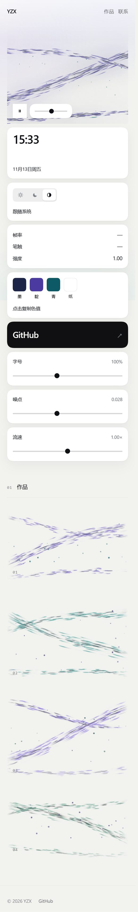
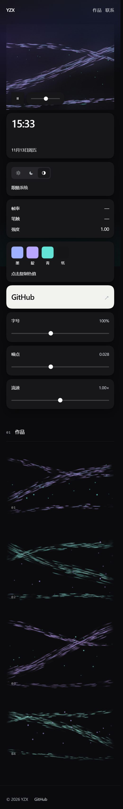

# YZX

个人网站。首屏是一块**可交互的设计板**：一幅会动的墨流、一台本地时钟、
主题 / 墨色 / 字号 / 噪点 / 流速这些真实可用的小控件，以及一个联系方式。
真实内容还没提供，所以页面上**没有任何占位文案**——版式、控件和实时状态
先把结构说清楚。


| 移动端（浅色） | 移动端（深色） |
| --- | --- |
|  |  |

## 首屏设计板

12 列网格。画板是暖灰的（浅色 `#f2f2ef`，深色 `#0b0b0d`），卡片是白色
（深色 `#17171a`）大圆角、无边框、一层软阴影。艺术区**不是卡片**：没有
表面、没有圆角，笔画在四边溶进画板；左下角浮着一组仪表。

| 卡片 | 做什么 |
| --- | --- |
| 墨流（艺术区） | Canvas 2D 生成，三条水流带、几百个粒子；鼠标/手指是穿过鱼群的东西 |
| 时钟 | 访客的本地时间与日期，每 15 秒刷新一次 |
| 主题 | 浅色 / 深色 / 跟随系统的分段控件，带 `aria-pressed`，存 localStorage |
| 墨色 | 四个色块按钮，点击复制该色块的 computed 颜色值 |
| 渲染状态 | 艺术层实时帧率、笔触数、当前墨色强度 |
| 字号 | 0.9–1.15× 缩放根字号，整站 rem 排版跟着变 |
| 噪点 | 0–0.07 的全局颗粒强度（CSS 变量驱动，实时生效） |
| 流速 | 0.4–1.6× 的墨流速度 |
| GitHub | 唯一的反白卡片，点击进主页 |

艺术区左下角的两个仪表是「暂停」按钮（WCAG 2.2.2）和墨色浓度滑杆。

## 技术栈

| 层 | 选择 | 为什么 |
| --- | --- | --- |
| 框架 | Astro 7（纯静态输出） | 页面是静态的，构建产物只有 HTML/CSS/两个模块脚本；没有运行时框架 |
| 语言 | TypeScript | 一次性写对，改起来放心 |
| 设计系统 | `dsh-ui-kit` 的 tokens + theme 运行时（vendored，MIT） | 颜色、排版、明暗主题都是现成的语义令牌，不引 UI 框架 |
| 艺术层 | Canvas 2D，手写约 500 行 | 不引入 three.js/动画库；桌面 60fps、单帧 1.7–4ms |
| 动效 | CSS scroll-driven + `@view-transition` | 渐进增强，`prefers-reduced-motion` 下全部退回静态 |
| 样式 | 单个全局 `site.css` | 没有 Tailwind：令牌已经提供了设计层 |

字体用系统栈，不下载 webfont。构建产物：JS 7.6 KB（gzip）、CSS 10.2 KB（gzip）。

## 命令

```bash
pnpm install
pnpm dev        # http://127.0.0.1:4321
pnpm build      # dist/
pnpm preview    # 预览构建产物
pnpm check      # astro check
```

## 目录

```
src/
  config.ts               站点元信息（标题、描述、社交链接、导航）
  layouts/Base.astro      head、首帧主题脚本、skip link
  pages/index.astro       首页：设计板 + 作品印张
  pages/404.astro
  components/             SiteHeader（字标 + 导航）/ SiteFooter（© + 社交）
  scripts/ascii-field.ts  生成艺术：水流带 + 群游 + 控制接口
  scripts/theme.ts        明暗主题运行时（唯一另一个脚本）
  design/tokens/          vendored 设计令牌（CSS）
  design/theme/           vendored 主题运行时（DOM-only）
  styles/site.css         站点样式（含 board 与卡片系统）
public/hero-field-*       艺术层静帧（仅 reduced-motion / 无 JS 时下载）
tools/                    截图、静帧、行为回归脚本
```

## 首页的艺术层

不是 ASCII，而是「墨流」：三条水流带（band）承载几百个粒子，沿各自的
spine 曲线游动，`destination-out` 逐帧擦出拖尾，笔画是圆头短线。
指针靠近时，粒子让开、拖出一段，再弹回自己的车道——像鱼群让开鲨鱼。

- **不跳帧**：时间轴 = `STATIC_TIME + elapsed + (now - startedAt)`，resize
  重建时按当前时间重画，不会回到第一帧。
- **性能**：桌面每帧 draw 1.7–4 ms；实测 rAF p50 = 8.3 ms（120Hz 满帧）。
  dpr 上限 1，省一半像素而视觉几乎无差。
- **控制**：`mountAsciiField()` 返回 `{ dispose, pause, play, setIntensity,
  setSpeed }`；设计板上的浓度/流速滑杆直接接这套接口。
- **回退**：`prefers-reduced-motion` 或无 JS 时显示 `public/hero-field-*.avif`
  静帧（约 72–75 KB），静帧由冻结模式渲染，与动画起始帧同刻。
- **暂停**：艺术区左下角按钮，冻结当前帧、恢复时补回暂停时间。
- **生命周期**：离屏 / 隐藏 / `content-visibility` 跳过时停止 rAF；
  `IntersectionObserver` 兜底。

重新生成静帧：

```bash
node tools/make-field-stills.mjs   # 需先 pnpm dev（或在脚本里改 base）
python tools/make-field-webp.py    # 生成 avif/webp + echo 底色 data URI
```

## 作品印张

四张印张是同一套系统的**冻结帧**，用 `seed` 改变流向，所以它们像同一系列
的四幅版画，而不是四张截图；每张在进入视口前 320px 才挂载，避免首屏
一次性 warm 四个 canvas。边缘用 mask 渐隐，不会露出画布边界。

## 质量检查

| 命令 | 检查什么 |
| --- | --- |
| `pnpm check` | 类型 + Astro 语法 |
| `node tools/theme-check.mjs` | system/light/dark 切换、localStorage、aria-pressed |
| `node tools/nojs-check.mjs` | 关 JS 后画布与文字可读 |
| `node tools/field-pause-check.mjs` | 暂停冻结、恢复继续、aria-label |
| `node tools/live-shot.mjs` | 指针唤醒的前后对比截图 |

Lighthouse 13（本机 Chrome，`pnpm preview --port 4322`）：

| 页面 | Performance | A11y | Best Practices | SEO | 关键指标 |
| --- | --- | --- | --- | --- | --- |
| 首页 · 移动端 | 100 | 100 | 100 | 100 | FCP 0.9 s、LCP 1.0 s、TBT 60 ms、CLS 0、23 KiB |
| 首页 · 桌面 | 100 | 100 | 100 | 100 | FCP 0.2 s、LCP 0.3 s、TBT 0 ms、CLS 0、23 KiB |

## 部署

构建产物是纯静态的：`pnpm build` → `dist/`。域名与托管由用户自行决定
（`astro.config.mjs` 里的 `site` 目前是占位值 `https://yzx.example.com`）。

## 已知取舍

- 没有内容：作品标题、文章、关于都等真实内容；现在不写字比写假字好。
- 印张是懒挂载的，第一次滚到那里会有一小段 warm-up 时间（约 100 ms）。
- 艺术层 dpr 限制为 1，在超高 dpi 屏上笔画会略软。
- 设计板卡片高度由网格行统一（桌面 144 px），内容再长需要调整行高。

## 致谢

- [dsh-ui-kit](https://github.com/24373054/dsh-ui-kit)：设计令牌与主题运行时（MIT）
- [living-ascii](https://github.com/24373054/living-ascii)：ASCII 草场的视觉语言学
- [modern-web-guidance](https://github.com/GoogleChrome/modern-web-guidance)：现代 Web 规范
