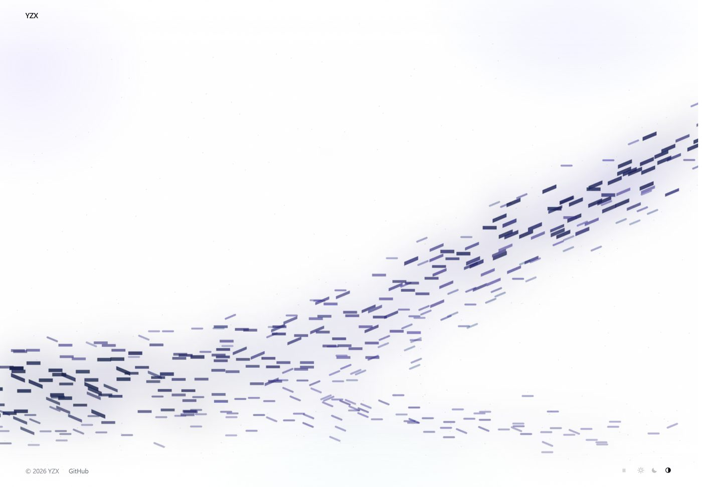

# YZX · 个人网站

一个零框架运行时的静态站点，目前只有两块内容：首页的一面「ASCII 风场」和 404 页。**站点的真实内容（作品、文章、关于）还没有写入**——页面上没有自造的文案、列表或占位说明；层级、留白与版面由样式承担，内容层等真实信息到位后再补。

- 首页首屏是一整块实时生成的艺术层：Canvas 2D 绘制的 ASCII 笔画风场，随时间和指针变化
- 明暗双主题 + 跟随系统，首帧不闪；主题与暂停控件收在页脚，不悬浮在画面上
- 减少动效 / 禁用 JS 时退回同一帧的静态图（AVIF/WebP，约 41–48 KB）
- 全站 JS ≈ 8 KB（主题运行时 + 风场模块，gzip 后约 4 KB），CSS ≈ 16 KB（gzip 后约 3.7 KB）
- 构建：Astro 7 静态输出，产物只有 `index.html`、`404.html`、`sitemap-index.xml`

## 设计原则

- **版式解释层级，文字不解释版式**。没有小标题、说明句、免责声明式的辅助文案；在真实内容到位前，页面宁可空着，也不拿自造文字填充。
- **艺术层是页面的一部分**，不是一张装饰卡片：画布铺满首屏、四边渐隐进纸面，页头页脚浮在画面上，没有任何边框、圆角容器或背景板。
- 少一层装饰就少一次解释：层级交给字号、间距、对齐和颜色。
- 视觉语言参考 [living-ascii](https://github.com/24373054/living-ascii)（MIT）：短笔画按风场转向、密度分层、逐格调色、胶片颗粒；实现改成零依赖的 Canvas 2D。
- 规范参考 Google Chrome 的 [modern-web-guidance](https://github.com/GoogleChrome/modern-web-guidance)：字号用 rem、`clamp()` 上下限比值 ≤ 2.5、`text-wrap: pretty/balance`、减少动效逐条关闭、深色模式由 `color-scheme` 驱动。该 skill 装在 `.agents/skills/` 并随仓库提交（见 `skills-lock.json`）。

## 预览

| 首页 · 浅色 | 首页 · 深色 |
| --- | --- |
|  |  |

| 移动端 · 浅色 | 移动端 · 深色 |
| --- | --- |
|  |  |

> 图片由 `tools/preview_images.py` 从 `.shots/` 的实拍截图生成；改版后先跑 `node tools/shots.mjs`，再跑这个脚本。

## 技术栈

| 层 | 选择 | 说明 |
| --- | --- | --- |
| 构建 | Astro 7.4 | 静态输出、sitemap，无内容集合、无 MDX |
| 语言 | TypeScript 5.9 | `astro check` 尚不支持 TS 7，故锁 5.9 |
| 样式 | DSH tokens + 原生 CSS | 令牌提供颜色/排版/阴影/圆角；无 Tailwind |
| 主题 | DSH theme runtime | 纯 TS、零依赖、零 React，只做 DOM 投影 |
| 艺术层 | Canvas 2D（手写） | `src/scripts/ascii-field.ts`，约 15 KB 源码，无第三方渲染库 |
| 内容 | 暂无 | 真实内容未提供；不预置示例文章或作品数据 |

不使用 Tailwind 是有意的：DSH 令牌已覆盖设计层，引入 Tailwind 只会产生第二套并行体系。样式集中在 `src/styles/site.css`。

## 本地命令

```bash
pnpm install
pnpm dev        # http://localhost:4321
pnpm build      # 输出到 dist/
pnpm preview    # 预览构建产物（注意：监听 [::1]，用 http://localhost:4322）
pnpm check      # astro check 类型检查（0 errors 是提交线）
```

Node 24.x（pnpm 10）。

## 目录

```text
src/
  config.ts              站点元信息（标题、简介、邮箱、社交链接、导航）
  design/tokens/         vendor 自 dsh-ui-kit 的设计令牌（CSS + 常量）
  design/theme/          vendor 自 dsh-ui-kit 的主题运行时（TS，无 React）
  layouts/Base.astro     文档骨架、meta、首帧主题脚本
  components/            SiteHeader（字标）/ SiteFooter（版权 + 控件）
  pages/index.astro      首页：一整块艺术层
  pages/404.astro        404
  scripts/theme.ts       客户端：ThemeRuntime + 主题按钮
  scripts/ascii-field.ts 首页艺术层（Canvas 2D，零依赖）
  styles/site.css        站点样式：全幅画布、页头页脚覆盖层、控件、404
public/                  favicon.svg、og.png、robots.txt、hero-field-{light,dark}.{avif,webp}
tools/                   截图、静帧生成、回归检查脚本
.agents/                 modern-web-guidance skill（随仓库提交）
```

## 首页的艺术层

`src/scripts/ascii-field.ts` 一帧大约 2–4 千个笔画：

- **构图**：两条方向不同的「水流」以柔和的带状铺在纸上——一条宽的斜向主带、一条底部细带；带外是稀疏的尘埃。电流由 `ribbon = exp(-(distance / width)²)` 定义，主带做非对称处理：迎风边利落、背风边拖尾。
- **笔触**：8 个角度档、4 档长度的精灵图集，惰性生成并缓存（`createAtlas`）。笔画角度跟随所在水流的切线，加一层缓慢的行波让它摆动。
- **深度**：密度同时决定权重、色调和透明度——密集的芯是深墨，边缘是淡笔，外面是尘埃。三档深度让大块留白也成立。
- **指针**：`PointerState` 每帧缓动（位置 0.14、强度进入 0.08 / 离开 0.05），靠近的笔画朝 `atan2` 方向偏转并轻微提亮，像风把草压开，而不是挖一个洞。
- **性能**：Dpr 上限 1、`MAX_CELLS = 6000`，桌面 60 fps（实测单帧 draw 约 1.7–4 ms），触屏 30 fps。颗粒从逐帧重绘改成 CSS 静态噪点（`.stage::after`），因为每帧随机重绘读起来像雪花，也是旧版最贵的一步。
- **不跳帧**：时间轴 `timeNow()` 在暂停、后台、离屏之间累积；`measure()` 只在尺寸或 dpr 变化时重建，并用 `timeNow()` 重绘，所以刷新、缩放、切回标签页都不会把画面弹回首帧。
- **生命周期**：`contentvisibilityautostatechange`（Baseline 2025）暂停离屏绘制，`IntersectionObserver` 兜底；`document.hidden` 暂停；`prefers-reduced-motion: reduce` 下完全不启动。
- **回退**：reduced-motion / 无 JS 显示 `hero-field-*.avif`（同一时刻的静帧，由 `node tools/make-field-stills.mjs` → `?still` 冻结模式生成，`python tools/make-field-webp.py` 转码并回写 1 KB 的 echo 数据 URI）。正常访问时静帧不下载。
- **暂停**：页脚的暂停按钮冻结当前帧（不黑屏）、恢复时补上暂停期间的时间；`aria-label` 在「暂停动画/播放动画」之间切换，不设 `aria-pressed`；reduced-motion 下按钮隐藏（此时本就没有动画）。

## 质量检查

```bash
node tools/shots.mjs            # 11 张截图到 .shots/（明暗、404、移动端、fold、指针唤醒）
node tools/make-field-stills.mjs && python tools/make-field-webp.py   # 重建静帧与 echo
python tools/preview_images.py  # 生成 docs/preview/*.jpg
node tools/theme-check.mjs      # 主题初始/切换/localStorage/aria-pressed/刷新保持
node tools/nojs-check.mjs       # 无 JS + 明暗 OS 的可读性
node tools/field-pause-check.mjs# 暂停冻结/恢复/aria-label
```

> 生成静帧、预览图需要本机 Chrome（脚本里写死了 Windows 的默认路径）与 bundled Python（Pillow）。

最近一次实测（Lighthouse 13.6，本机 Chrome，`pnpm preview` 后测 `http://localhost:4322`）：

| 页面 | 性能 | 无障碍 | 最佳实践 | SEO | 关键指标 |
| --- | --- | --- | --- | --- | --- |
| 首页（移动端模拟） | 100 | 100 | 100 | 100 | FCP 0.8 s · LCP 0.8 s · TBT 0 ms · CLS 0 · 18 KiB |
| 首页（桌面） | 100 | 100 | 100 | 100 | FCP 0.2 s · LCP 0.3 s · TBT 0 ms |
| 404（移动端模拟） | 100 | 100 | 100 | 66 | SEO 只触发一条 `is-crawlable`，来自 404 的 `noindex`，属预期 |

## 已知取舍

- 首页是一个 canvas 艺术层，禁用 JS 或减少动效时使用静态图；首错位风险靠「静帧 = 动画首帧」的位置与时间对齐来消除。
- 全幅画布按 dpr 1 渲染，超大屏（> 2560 逻辑像素）上笔画会比系统字体略显软；这是为 60 fps 换来的。
- `og.png` 是构建期静态图，暂未随艺术层重绘。
- 站点内容层为空：作品、文章、关于等页面与导航在实际内容确定后补；当前 `site.nav` 为空数组，页头只显示字标。

## 致谢

- [dsh-ui-kit](https://github.com/24373054/dsh-ui-kit)：设计令牌与主题运行时（MIT，已 vendor）
- [living-ascii](https://github.com/24373054/living-ascii)（yusen-dev，MIT）：ASCII 风场的视觉语言
- [modern-web-guidance](https://github.com/GoogleChrome/modern-web-guidance)（Google Chrome）：动效、排版、深色模式与后台处理规范
