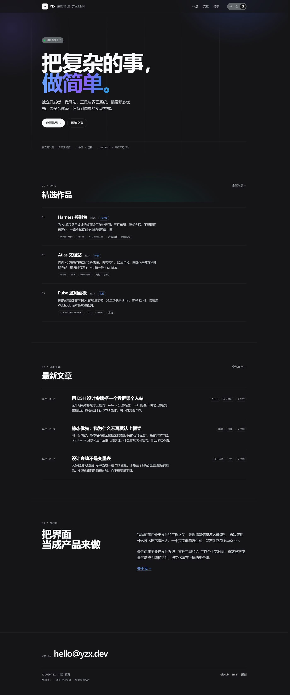
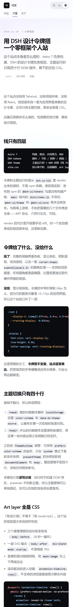

# YZX · 个人网站

一个零框架运行时的静态个人站：Astro 7 负责构建，视觉层用 DSH 的设计令牌（vendor 源码），客户端只有一个几 KB 的主题模块。

- 首页 / 作品 / 文章 / 关于 / 404，共 8 个静态页面
- 明暗双主题 + 跟随系统，首帧不闪
- 全站 JS ≈ 11 KB（构建后，含主题运行时），CSS ≈ 50 KB（gzip 后约 9 KB）
- 部署目标：任意静态托管，推荐 Cloudflare Pages

## 预览

| 首页 · 浅色 | 首页 · 深色 |
| --- | --- |
|  |  |

文章页（`/writing/static-first`）：


移动端：

| 首页 | 文章 |
| --- | --- |
|  |  |

> 图片由 `tools/preview_images.py` 从 `.shots/` 的实拍截图生成，改版后重跑即可。

## 技术栈

| 层 | 选择 | 说明 |
| --- | --- | --- |
| 构建 | Astro 7.4 | 静态输出、内容集合、MDX、sitemap、RSS |
| 语言 | TypeScript 5.9 | `astro check` 尚不支持 TS 7，故锁 5.9 |
| 样式 | DSH tokens + 原生 CSS | 令牌提供颜色/排版/阴影/圆角；无 Tailwind |
| 主题 | DSH theme runtime | 纯 TS、零依赖、零 React，约 40 行 DOM 投影 |
| 内容 | MDX + content collections | frontmatter 由 Zod schema 在构建期校验 |

不使用 Tailwind 是有意的：DSH 令牌已覆盖设计层，引入 Tailwind 只会产生第二套并行体系。样式集中在 `src/styles/site.css`，用命名约定（`shell` / `section` / `row` / `prose`）约束作用域。

## 本地命令

```bash
pnpm install
pnpm dev        # http://localhost:4321
pnpm build      # 输出到 dist/
pnpm preview    # 预览构建产物
pnpm check      # astro check 类型检查（0 errors 是提交线）
```

Node 版本：24.x（本仓库用 pnpm 10）。

## 目录

```text
src/
  config.ts             站点元信息（标题、简介、导航、社交链接、邮箱）
  data/projects.ts      作品列表（纯数据，改这里即可）
  content.config.ts     文章 frontmatter 的 Zod schema
  content/writing/*.mdx 文章
  design/tokens/        vendor 自 dsh-ui-kit 的设计令牌（CSS + 常量）
  design/theme/         vendor 自 dsh-ui-kit 的主题运行时（TS，无 React）
  layouts/Base.astro    文档骨架、meta、首帧主题脚本
  components/           SiteHeader / SiteFooter / WorkRow / PostRow
  pages/                index / work / writing / about / 404 / rss.xml
  scripts/theme.ts      客户端：ThemeRuntime + 主题按钮
  styles/site.css       站点层样式（显示级字阶、编排、art layer）
  lib/format.ts         日期格式化 + 阅读时长
public/                 favicon.svg、og.png、robots.txt
tools/                  og 图生成、截图与裁剪脚本（仅本地用）
refs/dsh-ui-kit/        vendor 的上游仓库（只读参考，不参与构建）
```

## 常见改动

**改站点信息**：`src/config.ts` 的 `site` 对象是唯一入口（标题、定位、首页宣言、邮箱、社交、导航、页脚 colophon）。

**加一个作品**：在 `src/data/projects.ts` 里追加一条。有 `href` 时整行变成外链（带箭头、hover 浮层）；没有则渲染成不可点的条目。`featured: true` 的进入首页。

**写一篇文章**：新建 `src/content/writing/我的文章.mdx`，frontmatter 必填项：

```yaml
---
title: 标题
description: 一句话摘要（会出现在列表和 meta description）
date: 2026-11-13
tags: ['设计系统', 'CSS']
draft: false   # 可选，true 时不上线
---
```

文件名即 URL：`/writing/<文件名>/`。列表按日期倒序，RSS 与 sitemap 自动更新。

**换配色**：优先改 `src/design/tokens/styles/design-platform.css` 里的 alias 映射，而不是组件里的颜色。要加自己的 token，写进 `src/styles/site.css` 的 `:root`，并确保明暗两套都有值。

## 主题机制

主题要解决三件事：首帧不闪、用户能手动切换、跟随系统时不重复计算。

1. `<head>` 内联脚本：在样式表之前读 `localStorage['site-theme']`，算出真实明暗，写 `html[data-ds-theme-source]` 和 `color-scheme`。
2. `<body>` 开头内联脚本：写 `body[data-ds-dark-theme]`（令牌的深色分支靠这个属性激活）。
3. `src/scripts/theme.ts`：`new ThemeRuntime({ persistence })` 接管系统主题监听，`presentTheme(runtime)` 把快照投影到 DOM；三个按钮通过 `runtime.setTheme('light' | 'dark' | 'system')` 更新偏好并持久化。

运行时不知道 DOM 存在，presenter 不判断主题——所以主题逻辑可以脱离浏览器单测，也可以换渲染目标。改主题行为时优先动这两层，而不是加新的全局状态。

## vendor 的 DSH 源码

`src/design/tokens` 和 `src/design/theme` 不是 npm 依赖，而是从 `refs/dsh-ui-kit`（MIT）复制过来的源码：

- tokens 的 npm 包不含构建产物（`main` 指向的 `dist/index.js` 不存在），theme/core 未发布，所以不能直接安装。
- 复制进仓库后，主题运行时的唯一外部引用被改成了本地 `../tokens` 常量。

**升级方式**：对比上游 `packages/tokens/src` 与 `packages/theme/src`，把差异同步进来，保持两处导入改写（`@dsh-ui/tokens` → `../tokens`、`./x.ts` → `./x`）。不要引入 `theme/react.ts`——它需要 React。

## 部署（Cloudflare Pages）

1. 把 `astro.config.mjs` 的 `site` 改成真实域名，`public/robots.txt` 里的 sitemap 地址同步改。
2. 推送到 GitHub，Cloudflare Pages 连接仓库：
   - Build command：`pnpm build`
   - Build output：`dist`
   - 环境变量：`NODE_VERSION=24`
3. 也可以手动上传：`pnpm build` 后把 `dist/` 拖给任意静态托管。

纯静态站点，无 SSR、无 API 路由，CDN 缓存即可；改文章等于重新构建一次。

## 质量检查

- `pnpm check` 应为 0 errors（当前 8 条 hint 是 Astro 内部 API 的 deprecated 提示之外的噪声，可忽略）。
- 构建后检查体积：`du -b dist/_astro/*.js dist/_astro/*.css`。
- 视觉回归：`tools/shots.mjs`（Playwright 驱动本机 Chrome，输出明暗 + 移动端截图到 `.shots/`），`tools/crop.py` 裁剪局部大图，`tools/preview_images.py` 把最终截图压成 `docs/preview/*.jpg`。
- Lighthouse（13.6，移动端模拟、`pnpm preview` + 本机 Chrome）：首页 100/100/100/100，FCP/LCP 1.1 s、TBT 0 ms、CLS 0、传输 18 KiB；文章页 100/100/100/100，FCP/LCP 0.8 s。
- 社交分享图：`tools/make_og.py` 用 Pillow 生成 `public/og.png`（1200×630），配色与站点一致；改品牌信息后重跑一次。

## 已知取舍

- 没有客户端路由和组件库，每加一个交互都要手写；换来的是没有水合、没有框架运行时。
- `astro check` 依赖 TypeScript 5.9，升级 Astro 主版本时再评估。
- 文章正文里的代码块由 Shiki 在构建期高亮，主题固定 `github-dark`（深色，两种站点主题下一致；选它而非 `github-dark-dimmed` 是因为后者注释色对比度不足 WCAG AA）。
